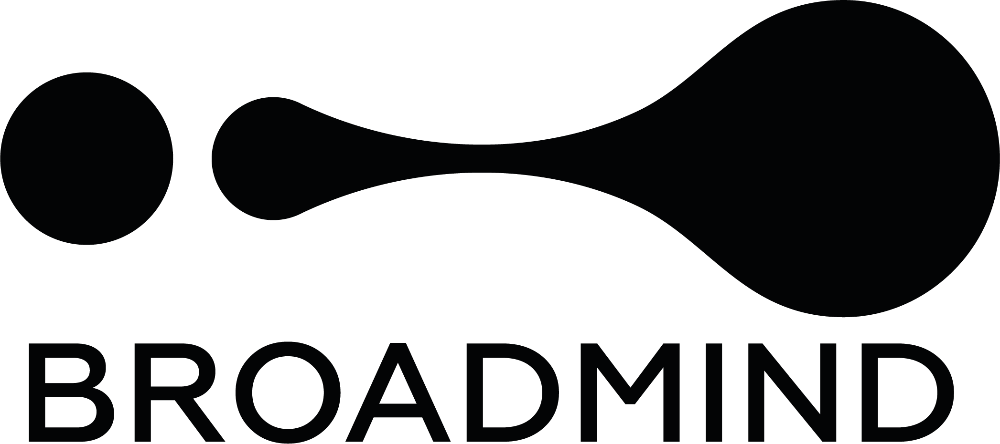

<p align="center">
  
</p>

<h1 align="center">BROADMIND GUI</h1>

<p align="center">
  Visualise and record EEG from OpenBCI-compatible hardware
</p>

> **Fork note.** This is a BROADMIND build of the OpenBCI GUI. The application is upstream
> [`OpenBCI/OpenBCI_GUI`](https://github.com/OpenBCI/OpenBCI_GUI), MIT-licensed, and nothing in the
> acquisition, protocol or board-support code was changed. This build differs in presentation:
> the BROADMIND brand system - black, white and one grey, set in Geometria where it is licensed and
> installed and Arial otherwise - with functional colours (channel identity, error states)
> deliberately preserved. Every upstream author credit and the licence are unchanged; see
> [LICENSE](LICENSE).

---

## Welcome!

Thank you for visiting the repository for BROADMIND's build of the OpenBCI GUI.

This document is a hub for the project. Jump to a section below, or just scroll down.

* [What are we doing? (And why?)](#what-are-we-doing)
* [Who are we?](#who-are-we)
* [What do we need?](#what-do-we-need)
* [How can you get involved?](#get-involved)
* [Get in touch](#contact-us)
* [Find out more](#find-out-more)
* [Installing](#installing)

## What are we doing?

### The problem

* People who own OpenBCI-compatible hardware - including the BROADMIND Research Kit - want to see
  their brainwaves as soon as the device arrives.
* They use macOS, Windows and Linux to acquire data.
* They want to filter incoming data in real time, and to get it out into MATLAB, Python or their own
  applications.
* They struggle to get prerequisites properly installed before they can record anything.

Even for experienced researchers there is a lot of work between unboxing a headset and trusting the
first recording.

### The solution

This GUI will:

* Visualise data from the **BROADMIND Research Kit** - [broadmind.me](https://broadmind.me)
* Run as a native application on macOS, Windows, and Linux.
* Provide filters and other data processing tools to quickly clean raw data in real time.
* Provide a networking system to move data out of the GUI into other apps over UDP, OSC, LSL and
  Serial.
* Provide a widget framework that allows users to create their own experiments.
* Provide the ability to output data into a saved file for later offline processing.

## Who are we?

**The GUI is OpenBCI's work.** The original code was written by Chip Audette, with Conor Russomanno
and Joel Murphy; AJ Keller, Gabriel Diaz, Daniel Lasry and Richard Waltman are among the major
contributors. That work is MIT-licensed, and every author credit is preserved in this repository.

**BROADMIND maintains this build.** BROADMIND makes an 8-channel dry-electrode EEG headset and the
open Python SDK that accompanies it ([broadmind-eeg](https://github.com/BROADMIND-BCI/broadmind-eeg)).
The fork changes presentation only: palette, type and marks.

## What do we need?

**Feedback on this build.** If something reads badly, sits at poor contrast, or looks wrong next to
the rest of the BROADMIND material, open an issue here.

For anything about acquisition, board support, or the protocol itself, the
[upstream project](https://github.com/OpenBCI/OpenBCI_GUI) is the right place - this fork does not
touch that code, so fixes belong there.

## Get involved

If you can help with the presentation of this build, or with the BROADMIND SDK, we would like to
hear from you. Please read our [contributors' guidelines](CONTRIBUTING.md) and our
[roadmap](ROADMAP.md) first.

It matters to us that this stays a positive and supportive environment. When you join us we ask that
you follow our [code of conduct](CODE_OF_CONDUCT.md) in all interactions, both on and offline.

## Contact us

To report a problem or suggest an enhancement in this build, please
[open an issue](../../issues) on this repository so we can get right on it.

## Find out more

* The hardware and the company: [broadmind.me](https://broadmind.me)
* The open Python SDK: [broadmind-eeg](https://github.com/BROADMIND-BCI/broadmind-eeg)
* A tutorial to [make your own GUI widget](https://docs.openbci.com/Software/OpenBCISoftware/GUIWidgets/#custom-widget)
* Upstream: [OpenBCI](https://www.openbci.com)

And of course, you'll want to know our:

* [Contributors' guidelines](CONTRIBUTING.md)
* [Roadmap](ROADMAP.md)

## Thank you

Thank you for visiting this project. BROADMIND's aim is an acquisition front-end that stays out of
the way of the measurement, and a recording you can open in the tools you already trust.

## Installing

This build runs on **Processing 4.5.x**. Open the sketch and press Run:

```bash
git clone https://github.com/BROADMIND-BCI/broadmind-gui.git
cd broadmind-gui
open -a Processing OpenBCI_GUI
```

The libraries the sketch needs ship inside `OpenBCI_GUI/libraries`, so Processing finds them without
anything being installed into your sketchbook. If you would rather follow the upstream guide, it is
[here](https://docs.openbci.com/Software/OpenBCISoftware/GUIDocs/#running-the-openbci-gui-from-the-processing-ide).

**Note: compatible with Processing 4.**

### System Requirements
#### Hardware
- 1.6 GHz or faster processor
- 2 GB of RAM
- 400 MB of hard drive space (minimum)

#### Platforms
This build is tested wherever upstream is; the platforms below are upstream's:
- OS X 10.15.7 or later
- Windows 8.1, 10, and 11 (64-bit)
- Linux Ubuntu Desktop 18 or later

OpenGL acceleration is required.

## Troubleshooting
- **When making an issue here on GitHub, please use an Issue or New Feature Template.** Otherwise, the issue will be closed and you will be asked to make a new issue using a template. This maintains a standard of communication and helps resolve issues in a timely manner.

- If you are on a Mac and you seem to get a "spinning wheel of death" when trying to open a dialog box to view files (example "SELECT PLAYBACK FILE" button), [please update your Java Runtime Environment](https://www.java.com/en/download/). This happens because Java was not packaged with a version of the GUI producing this error.

- For more on GUI troubleshooting, head over to the [GUI Troublshooting Doc](https://docs.openbci.com/Troubleshooting/GUI_Troubleshooting/).

## Diagram

Here is a Work-in-progress diagram outlining the most important parts of the GUI. Created using https://app.diagrams.net/.

<p align="center">
  
</p>

## <a name="license"></a> License:

MIT

## Links

**BROADMIND**

- [BROADMIND Research Kit](https://broadmind.me)
- [BROADMIND SDK (broadmind-eeg)](https://github.com/BROADMIND-BCI/broadmind-eeg)

**Upstream - OpenBCI**

- [OpenBCI main site](https://www.openbci.com)
- [Upstream GUI repository](https://github.com/OpenBCI/OpenBCI_GUI)
- [GUI widget tutorial](https://docs.openbci.com/Software/OpenBCISoftware/GUIWidgets/#custom-widget)
- [Run GUI from Processing IDE](https://docs.openbci.com/Software/OpenBCISoftware/GUIDocs/#running-the-openbci-gui-from-the-processing-ide)

---

<p align="center">
  
</p>
<p align="center">
  BROADMIND · <a href="https://broadmind.me">broadmind.me</a>
</p>
