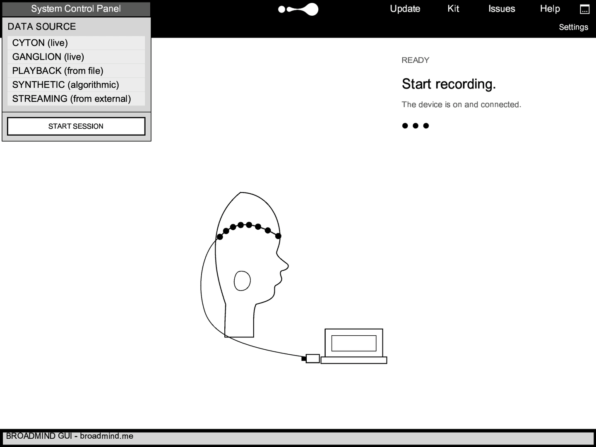
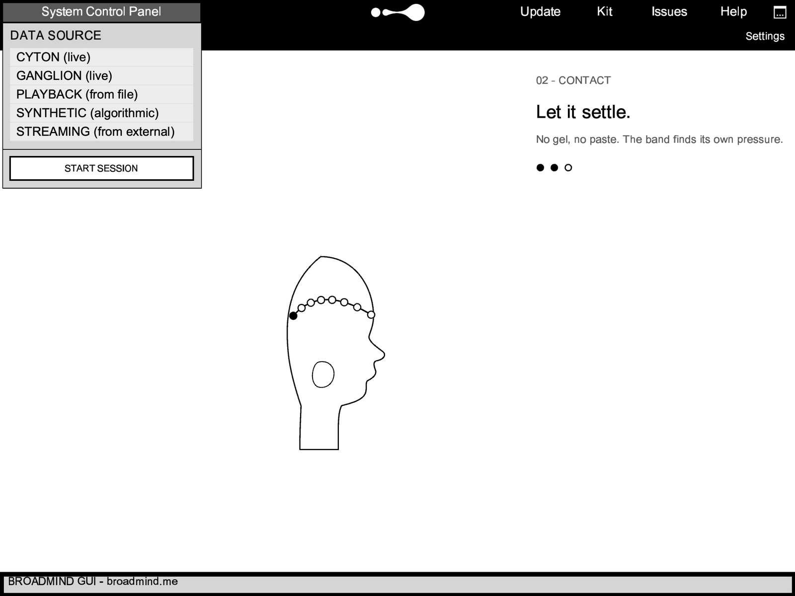
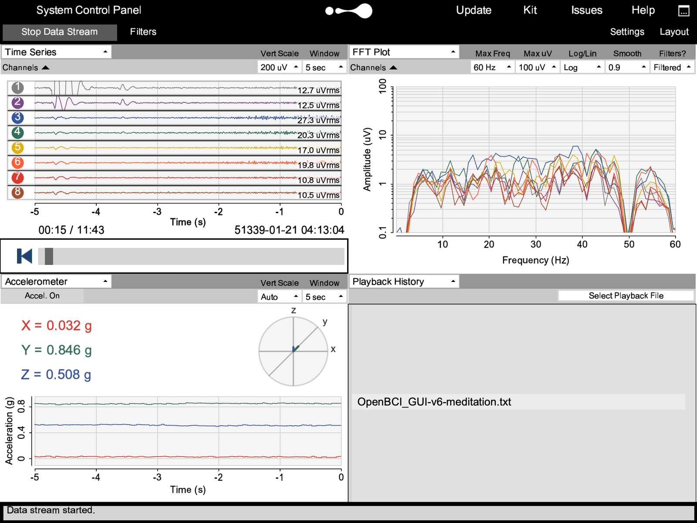
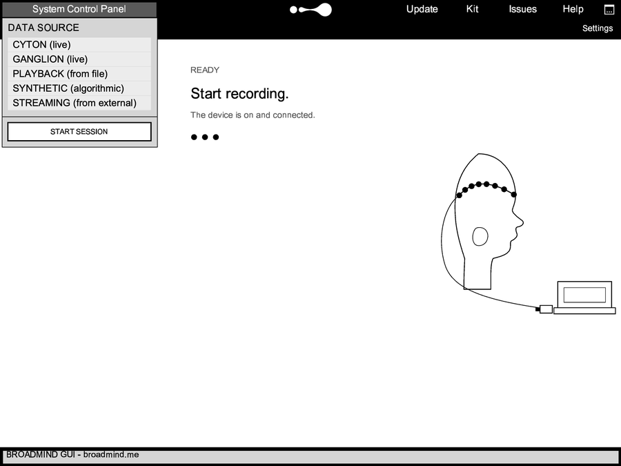

<p align="center">
  
</p>

<h1 align="center">BROADMIND GUI</h1>

<p align="center">
  Visualise and record EEG from the BROADMIND Research Kit - Cyton over USB<br>
  <strong>v0.3.0 Alpha &middot; November 2026</strong>
</p>

---

## Watch the demo

15 seconds, no narration: the starter page runs through its cycle, then a playback session streams.

[](docs/media/broadmind-gui-demo.mp4)

[Download the demo video (MP4, 1.1 MB, 1440x1080)](docs/media/broadmind-gui-demo.mp4)

## Screenshots

<p align="center">
  
</p>
<p align="center"><em>System control panel - ink window frame, white workspace, the mark centred.</em></p>

<p align="center">
  
</p>
<p align="center"><em>A session: time series, FFT and accelerometer, eight channels streaming.</em></p>

Both captures are from the running application, not mockups. The session view uses a bundled
recording, so the waveforms are real data.

## What's new in 0.3.0 (alpha)

**Scope: the Cyton over USB, on Apple Silicon macOS.** This release narrows the build deliberately
rather than pretending to cover every board and platform.

| Change | Detail |
|---|---|
| Cyton-only interface | The Ganglion is no longer offered: no source entry, no panels, no impedance widget. Its BLE scanner is gone too - on macOS it raised a Bluetooth permission prompt for a source we do not support. |
| BrainFlow 5.10.0 -> 5.13.3 | Brings the upstream Cyton fixes: impedance-check board configuration, analog-read values, and impedance accuracy at low resistances. |
| Smoother traces | The dongle delivers samples in bursts (~4 every 16 ms); the display used to jump with each burst. A buffer-layer pacer now releases samples at the nominal 250 Hz rate. Recordings are untouched - the logger writes the board's frames directly. |
| Readable controls | Auto-connect is no longer ink-on-ink, and the output-format button says BROADMIND. |
| Honest performance | Frame rate capped at 60 (the 120 request was never reached) while keeping crisp 2x retina rendering. |

The mobile companion is planned in [docs/MOBILE-APP-PLAN.md](docs/MOBILE-APP-PLAN.md).

Read the engineering detail in [docs/CYTON-BASELINE.md](docs/CYTON-BASELINE.md) - including what is
**verified** and what still needs hardware - and the cross-client spec in
[docs/ENGINE-CONTRACT.md](docs/ENGINE-CONTRACT.md).

## Welcome!

Thank you for visiting the repository for BROADMIND's build of the OpenBCI GUI.

This document is a hub for the project. Jump to a section below, or just scroll down.

* [What are we doing? (And why?)](#what-are-we-doing)
* [Who are we?](#who-are-we)
* [What do we need?](#what-do-we-need)
* [How can you get involved?](#get-involved)
* [Get in touch](#contact-us)
* [Find out more](#find-out-more)
* [Installing](#installing)

## Shipping it to other people

`tools/build-standalone.sh` produces a single `BROADMIND GUI.app` that runs without Processing and
without this repository — 673 MB, containing the Java runtime, the sketch libraries and a licence
bundle. Everything the app writes goes to `~/Documents/BROADMIND GUI/`.

It is verified by hiding `Processing.app` and confirming the app still reaches
`Setup is complete`. Size, legal position and the release checklist are in
[docs/DISTRIBUTION.md](docs/DISTRIBUTION.md) — including the four inherited libraries whose
licences are **not yet confirmed**, which is why the bundle is internal-use only for now.

## Checking a release

```bash
tools/verify-release.sh                                   # uses /Applications/Processing.app
PROCESSING_APP=/path/to/Processing.app tools/verify-release.sh
```

Checks cover version consistency between the sketch, CHANGELOG and README, arm64 natives for JNA and
jSerialComm, the brand palette and absence of legacy OpenBCI blues, stray capture hooks, relative
links, then a real compile, a real launch and a playback session that must start streaming on its
own. Exit code 0 means ready.

## Starter page design

The onboarding screen is designed in [docs/design](docs/design): a black-and-white outline schematic
of the headset being put on and connected by USB. It is built into the application, not a mockup -
this is the running app (13.5 s cycle):

<p align="center">
  
</p>

The schematic is centred on the window and painted **underneath** the interface: an open
data-source sub-panel covers it rather than pushing it aside, so the page never slides or shrinks.
The copy sits in a fixed right-hand column, clear of the panel at its widest, so nothing is truncated.

## What are we doing?

### The problem

* People who own OpenBCI-compatible hardware - including the BROADMIND Research Kit - want to see
  their brainwaves as soon as the device arrives.
* They use macOS, Windows and Linux to acquire data; this build targets Apple Silicon macOS first.
* They want to filter incoming data in real time, and to get it out into MATLAB, Python or their own
  applications.
* They struggle to get prerequisites properly installed before they can record anything.

Even for experienced researchers there is a lot of work between unboxing a headset and trusting the
first recording.

### The solution

This GUI will:

* Visualise data from the **BROADMIND Research Kit** - [broadmind.me](https://broadmind.me)
* Run as a native application on **macOS (Apple Silicon)** today; Windows and Linux run from source.
* Provide filters and other data processing tools to quickly clean raw data in real time.
* Provide a networking system to move data out of the GUI into other apps over UDP, OSC, LSL and
  Serial.
* Provide a widget framework that allows users to create their own experiments.
* Provide the ability to output data into a saved file for later offline processing.

## Who are we?

**The GUI is OpenBCI's work.** The original code was written by Chip Audette, with Conor Russomanno
and Joel Murphy; AJ Keller, Gabriel Diaz, Daniel Lasry and Richard Waltman are among the major
contributors. That work is MIT-licensed, and every author credit is preserved in this repository.

**BROADMIND maintains this build.** BROADMIND makes an 8-channel dry-electrode EEG headset and the
open Python SDK that accompanies it ([broadmind-eeg](https://github.com/BROADMIND-BCI/broadmind-eeg)).
The fork changes presentation only: palette, type and marks.

## What do we need?

**Feedback on this build.** If something reads badly, sits at poor contrast, or looks wrong next to
the rest of the BROADMIND material, open an issue here.

For anything about acquisition, board support, or the protocol itself, the
[upstream project](https://github.com/OpenBCI/OpenBCI_GUI) is the right place - this build does not
touch that code, so fixes belong there.

## Get involved

If you can help with the presentation of this build, or with the BROADMIND SDK, we would like to
hear from you. Please read our [contributors' guidelines](CONTRIBUTING.md) and our
[roadmap](ROADMAP.md) first.

It matters to us that this stays a positive and supportive environment. When you join us we ask that
you follow our [code of conduct](CODE_OF_CONDUCT.md) in all interactions, both on and offline.

## Contact us

To report a problem or suggest an enhancement in this build, please
[open an issue](../../issues) on this repository so we can get right on it.

## Find out more

* The hardware and the company: [broadmind.me](https://broadmind.me)
* The open Python SDK: [broadmind-eeg](https://github.com/BROADMIND-BCI/broadmind-eeg)
* A tutorial to [make your own GUI widget](https://docs.openbci.com/Software/OpenBCISoftware/GUIWidgets/#custom-widget)
* Upstream: [OpenBCI](https://www.openbci.com)

And of course, you'll want to know our:

* [Contributors' guidelines](CONTRIBUTING.md)
* [Roadmap](ROADMAP.md)

## Thank you

Thank you for visiting this project. BROADMIND's aim is an acquisition front-end that stays out of
the way of the measurement, and a recording you can open in the tools you already trust.

## Installing

### Homebrew (recommended)

```bash
brew tap broadmind-bci/broadmind-gui
brew trust --tap broadmind-bci/broadmind-gui   # Homebrew 7 refuses untrusted third-party taps
brew install --cask broadmind-gui
```

The cask downloads the standalone disk image, verifies it against its recorded checksum and installs
`BROADMIND GUI.app` to `/Applications`. No Processing install, no build step. Installing through
`brew` also clears the quarantine flag, which is the supported route while the build is unnotarised.

### From source

This build runs on **Processing 4.5.x**. Open the sketch and press Run:

```bash
git clone https://github.com/BROADMIND-BCI/broadmind-gui.git
cd broadmind-gui
open -a Processing BROADMIND_GUI
```

The libraries the sketch needs ship inside `BROADMIND_GUI/libraries`, so Processing finds them without
anything being installed into your sketchbook.

To build the standalone bundle yourself: `tools/build-standalone.sh` (see
[docs/DISTRIBUTION.md](docs/DISTRIBUTION.md)).

### System Requirements
#### Hardware
- 1.6 GHz or faster processor
- 2 GB of RAM
- 400 MB of hard drive space (minimum)

#### Platforms
- **macOS 13 or later, Apple Silicon only.** The bundled runtime is arm64; Intel Macs cannot run it.
- Windows and Linux run from source with Processing, as upstream does, but they are not packaged or
  tested by us.
- The wireless (Ganglion/BLE) path is not supported in this build.

OpenGL acceleration is required.

## Troubleshooting
- **When making an issue here on GitHub, please use an Issue or New Feature Template.** Otherwise, the issue will be closed and you will be asked to make a new issue using a template. This maintains a standard of communication and helps resolve issues in a timely manner.

- If you are on a Mac and you seem to get a "spinning wheel of death" when trying to open a dialog box to view files (example "SELECT PLAYBACK FILE" button), [please update your Java Runtime Environment](https://www.java.com/en/download/). This happens because Java was not packaged with a version of the GUI producing this error.

- For more on GUI troubleshooting, head over to the [GUI Troublshooting Doc](https://docs.openbci.com/Troubleshooting/GUI_Troubleshooting/).

## Diagram

Here is a Work-in-progress diagram outlining the most important parts of the GUI. Created using https://app.diagrams.net/.

<p align="center">
  
</p>

## <a name="license"></a> License:

MIT

## Links

**BROADMIND**

- [BROADMIND Research Kit](https://broadmind.me)
- [BROADMIND SDK (broadmind-eeg)](https://github.com/BROADMIND-BCI/broadmind-eeg)

**Upstream - OpenBCI**

- [OpenBCI main site](https://www.openbci.com)
- [Upstream GUI repository](https://github.com/OpenBCI/OpenBCI_GUI)
- [GUI widget tutorial](https://docs.openbci.com/Software/OpenBCISoftware/GUIWidgets/#custom-widget)
- [Run GUI from Processing IDE](https://docs.openbci.com/Software/OpenBCISoftware/GUIDocs/#running-the-openbci-gui-from-the-processing-ide)

---

<p align="center">
  
</p>
<p align="center">
  BROADMIND · <a href="https://broadmind.me">broadmind.me</a>
</p>

---

## Upstream and provenance

This is a BROADMIND build of the OpenBCI GUI. The application is upstream
[`OpenBCI/OpenBCI_GUI`](https://github.com/OpenBCI/OpenBCI_GUI), MIT-licensed, and nothing in the
acquisition, protocol or board-support code was changed. This build differs in presentation:
the BROADMIND brand system - black, white and one grey, set in Geometria where it is licensed and
installed and Arial otherwise - with functional colours (channel identity, error states)
deliberately preserved. Every upstream author credit and the licence are unchanged; see
[LICENSE](LICENSE) and [PROVENANCE.md](PROVENANCE.md).
